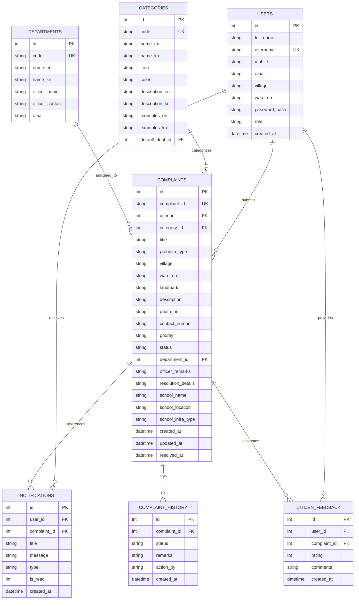

# Grama Seva – Smart Gram Panchayat Complaint Management Portal

> **"Your Village, Your Voice • ನಿಮ್ಮ ಗ್ರಾಮ, ನಿಮ್ಮ ಧ್ವನಿ"**  
> *A modern, responsive, and functional web-based civic grievance redressal portal for Gram Panchayats in rural India.*

---

## 🏛️ Executive Summary

**Grama Seva** is a full-stack, civic-tech web portal engineered for rural Gram Panchayats in India. It empowers villagers to file complaints online regarding essential services (such as drinking water leaks, broken streetlights, road potholes, and damaged government school infrastructure), track grievance progress through an intuitive 5-stage visual stepper, and receive real-time notifications.

For Gram Panchayat administrators and Panchayat Development Officers (PDO), the platform provides an administrative suite featuring real-time Chart.js analytics, department workload management, grievance resolution logs, and one-click CSV report exports.

---

## 🎨 Design System & Theme

Crafted with a government service aesthetic inspired by the National & Karnataka Panchayati Raj digital initiatives:

- **Primary Colour:** Forest Green (`#166534`) – Signifying rural development, sustainability, and panchayat authority.
- **Secondary Colour:** Pure White (`#FFFFFF`) – Clean cards, crisp typography, and readable tables.
- **Accent Colour:** Saffron Gold (`#F59E0B` / `#D97706`) – Civic pride, urgent call-to-actions, and official badges.
- **Background:** Light Grey-Green (`#F5F8F5`) – Easy on the eyes for extended viewing.
- **Text:** Dark Charcoal (`#1F2937`) – High-contrast readability.
- **Typography:** Inter & Poppins Google Fonts.
- **Bilingual Interface:** Instant switcher between **English** and **Kannada (ಕನ್ನಡ)**.
- **Responsive Layout:** Desktop sidebar / Topbar and Mobile-optimized bottom navigation bar.

---

## 🛠️ Technology Stack

| Layer | Technologies Used |
| :--- | :--- |
| **Frontend** | HTML5, CSS3 (Custom Design System), JavaScript (ES6+), Font Awesome 6 |
| **Charts** | Chart.js 4.4 |
| **Backend** | Python 3, Flask 3.1 |
| **Security** | Werkzeug (PBKDF2 Password Hashing, Secure Filename, Session Protection) |
| **Database** | SQLite3 (Normalized Relational Schema with Foreign Keys & Audit Trails) |
| **Testing** | Python `unittest` (Comprehensive 14-point Automated Test Suite) |

---

## 📑 Detailed Page Directory (12 Pages)

### 1. Citizen Login & Registration (`/login`, `/register`, `/forgot-password`)
- Gram Panchayat official emblem & village scenic illustration.
- Tabbed switch between **Citizen Login**, **New Account Registration**, and **Forgot Password**.
- Show / Hide password visibility toggle.
- 10-digit mobile number validation and secure password hashing.
- One-click demo credentials auto-fill.
- Direct pathway link to the Administrator Portal.

### 2. Citizen Dashboard (`/dashboard`)
- Welcoming banner: *"Together, Let's Build a Better Village."*
- 4 Summary Metric Cards: **Total Complaints**, **Pending Review**, **In Progress**, and **Resolved**.
- Direct *"Submit a Complaint"* action button.
- Quick-launch grid of all 9 complaint categories.
- Recent complaints table with live status badges.

### 3. Complaint Categories (`/categories`)
- Interactive, beautifully styled grid of **9 official categories**:
  1. 💧 **Water Supply:** Pipeline bursts, drinking water shortages, defunct taps/borewells.
  2. 🛣️ **Roads & Transportation:** Hazardous potholes, asphalt damage, muddy access roads.
  3. 💡 **Streetlights:** Non-glowing lights, damaged poles, exposed electrical wires.
  4. 🗑️ **Garbage Collection:** Overflowing public dustbins, uncollected roadside waste heaps.
  5. 🚰 **Drainage & Sanitation:** Clogged storm drains, sewage overflow, stagnant wastewater.
  6. 🏫 **Government School Problems:** Damaged classrooms, broken/unclean toilets, drinking water, electricity faults, broken desks/benches, damaged compound walls.
  7. 🏥 **Public Health Facilities:** Sub-Center sanitation, defunct handpumps, basic amenity shortages.
  8. 🏛️ **Public Facilities:** Damaged community halls (*Samudaya Bhavana*), bus shelters, libraries.
  9. 📄 **Other Problems:** Stray cattle menace, land encroachments, unlisted civic problems.
- Selecting any category opens the complaint submission form with that category pre-selected!

### 4. Submit Complaint Form (`/submit-complaint`)
- Dynamic conditional fields: When *"Government School Problems"* is selected, special fields appear:
  - *School Name* (e.g. Government Higher Primary School)
  - *School Location*
  - *Specific Infrastructure Defect* (classrooms, toilets, drinking water, desks/benches, compound wall)
- Auto-populated problem types based on selected category.
- Drag-and-drop image dropzone with **live client-side preview** and remove button.
- Comprehensive client & server-side validation.
- Generates a **unique sequential ID** (e.g., `GS-2026-00101`).
- Post-submission celebration modal with tracking link.

### 5. Complaint Tracking & Stepper (`/track`, `/track/<id>`)
- Universal search bar to track any grievance by ID.
- **5-Stage Visual Progress Stepper**:
  - `Submitted` (Blue) &rarr; `Under Review` (Orange) &rarr; `Assigned to Department` (Indigo) &rarr; `Work in Progress` (Purple) &rarr; `Resolved` (Green).
  - Also handles `Rejected` status with crimson alert banner and officer explanation.
- Displays citizen's original statement, landmark, and **uploaded photo evidence**.
- **Official Status Audit Trail**: Step-by-step history log with timestamps and officer remarks.

### 6. My Complaints (`/my-complaints`)
- Citizen grievance ledger.
- Filter tabs: *All Complaints*, *Pending*, *In Progress*, *Resolved*, *Rejected*.
- Search bar filtering by ID, title, or landmark.
- Desktop table view with quick *"View Details"* action and mobile card layout.

### 7. Notifications (`/notifications`)
- Event-driven notifications generated dynamically when:
  - Complaint is registered.
  - Officer updates the status.
  - Lineman or contractor begins work on site.
  - Complaint is resolved with completion remarks.
- Unread notification counter badge in navigation bar.

### 8. Dedicated Admin Login (`/admin/login`)
- Separate, secured portal login for authorized Panchayat Development Officers (PDO) and supervisors.
- Backend role verification (`role == 'admin'`). Citizens cannot access administrative controls merely by typing the URL.

### 9. Admin Dashboard (`/admin/dashboard`)
- 6 Metric Cards: **Total**, **New Submitted**, **Pending Review**, **In Progress**, **Resolved**, and **Overdue (>7 Days)**.
- **4 Interactive Chart.js Visualizations**:
  - 🍩 *Complaints by Civic Category* (Doughnut)
  - 📊 *Monthly Registration & Resolution Trends* (Grouped Bar)
  - 🗺️ *Ward-Wise Grievance Distribution* (Horizontal Bar for Wards 1 to 5)
  - 🥧 *Resolution Status Breakdown* (Pie Chart)
- Urgent grievances action table.

### 10. Admin Complaint Management (`/admin/complaints`)
- Multi-faceted filter toolbar: Status, Category, Priority, Ward, and Text Search.
- **Officer Action Modal**:
  - View full complaint description and high-resolution photo evidence.
  - Update status (`Submitted`, `Under Review`, `Assigned`, `In Progress`, `Resolved`, `Rejected`).
  - Assign to designated department/lineman cell.
  - Special routing for School Issues (Gram Panchayat Education Committee or Block Education Office).
  - Add official public remarks visible to the citizen.
  - Record resolution details upon completion.

### 11. Reports & Analytics (`/admin/reports`)
- Comprehensive Key Performance Indicators (KPIs):
  - Total grievances registered.
  - Resolution success rate (%).
  - Average resolution turnaround time (hours).
- Detailed breakdown tables for Categories, Department Workloads, and Ward-Wise metrics.
- **Export to CSV**: Working download button that exports a UTF-8 formatted CSV file (`Grama_Seva_Complaints_YYYYMMDD_HHMMSS.csv`) for Excel and offline reporting.

### 12. Help, Support & FAQs (`/help`)
- 3-step citizen guide: *How to File*, *Panchayat Assignment*, *Live Tracking*.
- Frequently Asked Questions accordion.
- Official Panchayat office address, working hours, and sample contact numbers.
- Citizen feedback form to rate panchayat service response (1 to 5 stars).

---

## 🗄️ Database Architecture (SQLite)

The database schema (`database.py`) consists of 7 normalized relational tables:



---

## 🔐 Security Best Practices

1. **Password Hashing:** Uses `werkzeug.security.generate_password_hash` with PBKDF2/SHA256. Plaintext passwords are never stored.
2. **Role-Based Access Control (RBAC):** Custom Python decorators `@login_required` and `@admin_required` enforce backend authorization. Attempting to access `/admin/*` routes as a citizen redirects with an access-denied security notice.
3. **Upload File Sanitization:** Enforces `secure_filename`, validates file extensions against a strict whitelist (`png`, `jpg`, `jpeg`, `webp`), and limits upload sizes to 10MB.
4. **SQL Injection Defense:** All queries utilize parameterized placeholders (`?`).
5. **Cross-Site Scripting (XSS) Prevention:** Jinja2 auto-escaping is active across all rendered variables.

---

## 🚀 Installation & Local Setup

### 1. Prerequisites
- Python 3.9 or higher (tested on Python 3.10 – 3.14)
- Web browser (Chrome, Edge, Firefox, Safari)

### 2. Clone or Navigate to Directory
```bash
cd "C:\Users\CHETHAN KUMAR S\.gemini\antigravity\scratch\grama-seva"
```

### 3. Install Dependencies
```bash
python -m pip install -r requirements.txt
```

### 4. Run the Application
```bash
python run.py
```
*(Alternatively, run `python app.py`)*

### 5. Access the Web Portal
Open your web browser and navigate to:
```
http://127.0.0.1:5000
```

---

## 🔑 Demo Credentials

| Role | Username / Mobile | Password | Notes |
| :--- | :--- | :--- | :--- |
| **Panchayat Officer (Admin)** | `admin` *(or 9845012345)* | `admin123` | Full access to Admin Dashboard, Charts, Status Updating & CSV Export |
| **Citizen (Voter)** | `citizen` *(or 9876543210)* | `citizen123` | Manjunath K. (Ward 2, Shivapura Main) with pre-seeded complaints & alerts |
| **Citizen 2** | `9876543211` | `citizen123` | Lakshmi Devi (Ward 3, Gollarahatti) |
| **New Citizen** | Register new | Custom | Instant auto-login & welcome alert |

---

## 🧪 Running Automated Tests

To run the complete automated test suite verifying all 12 pages, authentication flows, complaint lifecycle, and CSV exports:

```bash
python test_portal.py
```

Expected Output:
```
Ran 14 tests in 0.668s
OK
[PASS] Database and 9 Categories Verified Successfully
[PASS] Page 1: Citizen Login & Registration Page Rendered
[PASS] Citizen Login Functional with Secure Password Hash Verification
[PASS] Page 2: Citizen Dashboard Rendered with Summary Cards & Categories Grid
[PASS] Page 3: Complaint Categories Grid (All 9 Categories) Verified
[PASS] Page 4: Complaint Submission & Unique ID Generation Verified
[PASS] Page 5: Complaint Tracking & Visual 5-Stage Stepper Verified
[PASS] Page 6: My Complaints Filterable Table Verified
[PASS] Page 7: Dynamic Event-Driven Notifications Verified
[PASS] Page 8: Admin Dedicated Login & Backend Role-Based Access Control Verified
[PASS] Page 9: Admin Dashboard with 6 Metrics & 4 Chart.js Datasets Verified
[PASS] Page 10: Admin Complaint Management & Status Progression Verified
[PASS] Page 11: Reports & Real CSV Export Download Verified
[PASS] Page 12: Help & Support + Bilingual Kannada/English Toggle Verified
```

---

## 📁 File Structure

```
grama-seva/
│   app.py                  # Main Flask application with all routes & APIs
│   database.py             # SQLite connection, schema definition & query helpers
│   seed_data.py            # Realistic demo dataset generator
│   create_assets.py        # Vector SVG graphic asset generator
│   run.py                  # Server runner with auto-initialization
│   test_portal.py          # 14-point automated test suite
│   requirements.txt        # Python dependency manifest
│   README.md               # Documentation & setup guide
│
├── static/
│   ├── css/
│   │   ├── style.css       # Core design system, variables & components
│   │   ├── dashboard.css   # Stepper, category cards & admin styles
│   │   └── responsive.css  # Mobile bottom nav & responsive breakpoints
│   ├── js/
│   │   ├── main.js         # Dynamic school fields, photo dropzone, modals
│   │   └── charts.js       # Chart.js initialization & data rendering
│   └── images/
│       ├── emblem.svg      # Official Grama Seva emblem
│       ├── village-hero.svg# Rural village landscape illustration
│       └── uploads/        # Uploaded complaint photographs
│
└── templates/
    ├── base.html           # Master layout with top tricolor ribbon & footer
    ├── login.html          # Page 1: Citizen Login & Registration
    ├── admin_login.html    # Page 8: Dedicated Admin Officer Login
    ├── dashboard.html      # Page 2: Citizen Dashboard
    ├── categories.html     # Page 3: Complaint Categories
    ├── submit_complaint.html# Page 4: Submit Complaint Form
    ├── track.html          # Page 5: Complaint Tracking & 5-Stage Stepper
    ├── my_complaints.html  # Page 6: My Complaints Filterable Table
    ├── notifications.html  # Page 7: Real-time Notifications
    ├── help.html           # Page 12: Help, Support & FAQs
    ├── profile.html        # Citizen Profile Information
    └── admin/
        ├── base_admin.html # Admin layout with sidebar navigation
        ├── dashboard.html  # Page 9: Admin Dashboard with Chart.js
        ├── complaints.html # Page 10: Admin Complaint Management
        ├── reports.html    # Page 11: Reports & Analytics with CSV Export
        ├── departments.html# Panchayat Departments directory
        └── users.html      # User & Citizen management directory
```

---

## 💡 Recommended Next Steps
Set `C:\Users\CHETHAN KUMAR S\.gemini\antigravity\scratch\grama-seva` as your active workspace in Antigravity or open the folder in your favorite code editor to explore and modify the application!
